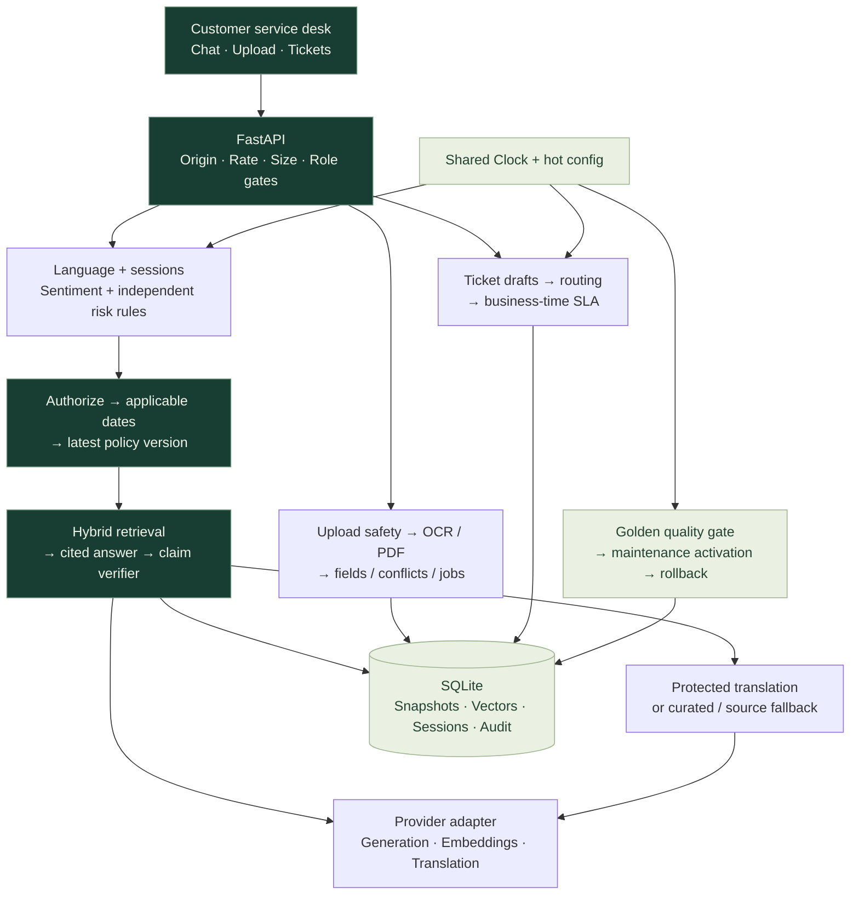

<p align="center">
  
</p>

<p align="center">
  <a href="https://github.com/rxp017/Real_Time_Gen_AI_Customer_Service_Bot/actions/workflows/ci.yml"></a>
  
  
  
</p>

<h1 align="center">Real-Time Gen AI Customer Service Bot</h1>

<p align="center">Policy answers with citations, document checks, and support tickets in one customer page.</p>

<p align="center"><a href="#run-it-locally">Quickstart</a> · <a href="#what-it-handles">Workflows</a> · <a href="docs/REPORT.md">Technical report</a> · <a href="docs/RTM.md">Requirements</a></p>


The service checks access, policy dates and versions before retrieving an answer. It asks for missing information or refuses when it lacks evidence. Uploads, conversation context and ticket routing use the same configuration, storage and clock.

The screenshot uses synthetic data. Run the app locally at [localhost:8000](http://127.0.0.1:8000/). A public demo is not deployed.

## Run it locally

Clone the project first:

```sh
git clone https://github.com/rxp017/Real_Time_Gen_AI_Customer_Service_Bot.git
cd Real_Time_Gen_AI_Customer_Service_Bot
```

### Docker

The image includes Tesseract with English, Hindi, Telugu and Spanish resources. It uses one worker and a persistent data volume.

```sh
[ -f .env ] || cp .env.example .env
docker build -t customer-service-bot .
docker run --rm -p 8000:8000 --env-file .env -v customer-service-data:/app/data customer-service-bot
```

The copy command above is for a POSIX shell. In PowerShell, use `if (-not (Test-Path .env)) { Copy-Item .env.example .env }`, followed by the same Docker commands.

<details>
<summary><strong>Linux / Ubuntu — Python 3.11</strong></summary>

Use an installed Python 3.11 interpreter, then install OCR and the pinned Python packages:

```sh
sudo apt-get update
sudo apt-get install -y python3-venv tesseract-ocr tesseract-ocr-eng tesseract-ocr-hin tesseract-ocr-tel tesseract-ocr-spa
python3.11 -m venv .venv
. .venv/bin/activate
python -m pip install -r requirements.txt
[ -f .env ] || cp .env.example .env
python scripts/check_ocr.py
python -m uvicorn app.chatbot:app --host 127.0.0.1 --port 8000 --workers 1
```

OCR uses PATH and auto-detects the system language directory. `python scripts/fetch_tessdata.py` can install tagged local language resources instead.

</details>

<details>
<summary><strong>Windows — PowerShell bootstrap</strong></summary>

Run from the project root. The bootstrap installs an isolated official Python 3.11.9 runtime, pinned dependencies and language resources, preserving an existing `.env`.

```powershell
if (-not (Get-Command tesseract -ErrorAction SilentlyContinue) -and -not (Test-Path (Join-Path $env:ProgramFiles 'Tesseract-OCR/tesseract.exe'))) {
    winget install --id UB-Mannheim.TesseractOCR --source winget --exact --version 5.4.0.20240606 --silent --accept-package-agreements --accept-source-agreements
}
.\scripts\bootstrap_windows.ps1
.\.runtime\python311\python.exe -m uvicorn app.chatbot:app --host 127.0.0.1 --port 8000 --workers 1
```

OCR prefers PATH, with the standard Windows installation as fallback. A runtime configuration override takes precedence over `TESSERACT_CMD`.

</details>

Open **[localhost:8000](http://127.0.0.1:8000/)**. For live generation, put your own Google key and distinct application role keys in `.env`. Uploads and tickets require a customer role key; the provider key belongs on the server. Without a configured provider, the application starts and refuses factual answers it cannot produce.

Generate application keys privately with `python -c "import secrets; print(secrets.token_urlsafe(32))"`. The [environment template](.env.example) lists each role. The documented generation model is `gemini-2.5-flash`; the example fallback list is empty because other candidates lack successful generation evidence. [Provider proof](docs/verification/provider-flash-probe.json).

## What it handles

| Task | Requirement → implementation | Representative verification |
| --- | --- | --- |
| **01 · Knowledge updates** | Normalize/hash, dedupe, quarantine, quality gate, maintenance activation and rollback → [ingestion](core/ingestion.py), [updates](core/updates.py), [store](core/store.py) | `test_duplicate_documents_detected` · `test_retry_15_30_60` · `test_quality_gate_uses_ingested_hybrid_vectors` |
| **02 · Document understanding** | Upload safety, real OCR/PDF extraction, conflicts, jobs and retention → [upload gate](core/upload_gate.py), [OCR](core/ocr.py), [uploads](core/uploads.py) | `test_missing_field_not_invented` · `test_mismatched_invoice_asks_clarification` · `test_expired_files_deleted` |
| **03 · Ticket handling** | Mandatory fields, priority, dedupe, routing and business-time SLA → [tickets](core/tickets.py), [priority](core/priority.py), [calendar](core/business_time.py) | `test_priority_formula` · `test_duplicate_ticket_merged` · `test_runtime_sla_change_recomputes` |
| **04 · Policy answers** | Authorized, applicable, latest-version hybrid retrieval and cited claims → [retrieval](core/retrieval.py), [embeddings](core/embeddings.py), [original FAQ import](core/training.py) | `test_filters_and_versions_precede_all_similarity` · `test_top_k_generation_verifies_each_citation_against_its_own_source` |
| **05 · Escalation** | History-aware sentiment, separate risk rules and masked handoff → [sentiment](core/sentiment.py), [risk](core/risk.py), [escalation](core/escalation.py) | `test_high_risk_independent_of_provider_positive_label` · `test_tone_changes_policy_unchanged` |
| **06 · Language & context** | Protected entities, language switching, corrections and isolated sessions → [language](core/language.py), [entities](core/entities.py), [sessions](core/sessions.py) | `test_provider_translation_preserves_original_entity_bytes` · `test_concurrent_sessions_isolated` |


See the [requirements matrix](docs/RTM.md) for the complete task-to-test mapping.

## Architecture



The shared [configuration](config/default.yaml) controls roles, thresholds, languages and timing. SQLite stores documents, snapshots, sessions, tickets and audit records. Retrieved text and uploads are treated as untrusted data.

## Try the workflows

These demos run offline with fixture data, FakeClock and FakeLLM:

```sh
python scripts/demo_t4.py
python scripts/demo_t1.py
python scripts/demo_t2.py
python scripts/demo_t3.py
python scripts/demo_t5.py
```

On Windows, use `.\.runtime\python311\python.exe` in place of `python`.

## Tests

```sh
python -m pytest -q
python -m ruff check .
python scripts/check_holdouts.py
```

The full local suite has 355 passing tests and one dependency deprecation warning. [Pytest output](docs/verification/tests.txt) · [Ruff output](docs/verification/lint.txt). CI runs the suite on Ubuntu and Windows and builds the Docker image.

## Current limits

Live model evaluation was quota-limited. The post-fix policy run returned 12/20 correct cited answers and 0/52 false answers, but was invalid because provider failures exceeded the registered 10% limit. Sentiment fallback scored 20/48; live translation probes returned HTTP 429. These results do not establish live model accuracy. OCR and rule-based recognition have limited coverage. Notifications are local records, and storage and timers require one running worker with persistent disk. Render Free sleeps and can lose local state. [Results and methods](docs/REPORT.md) · [Known gaps](docs/known_gaps.md).

## Background and documentation

Built on the mentor's [customer_service_chatbot_LLM training project](https://github.com/aslin72/GEN---AI-course/tree/main/GEN---AI-course/customer_service_chatbot_LLM). The original `src/` entry points and `dataset/dataset.csv` are retained. Its FAQs are imported as documents with metadata; the legacy Streamlit chain remains unverified.

- [Technical report](docs/REPORT.md) and [PDF](docs/REPORT.pdf)
- [Deployment guide](docs/deploy-render.md) and [OCR setup](docs/setup.md)
- [Retrieval design](docs/hybrid-retrieval.md) and [ticket priority formula](docs/priority.md)
- [Task requirements and tests](docs/RTM.md), [assumptions](docs/assumptions.md), [original baseline](docs/baseline.md)
