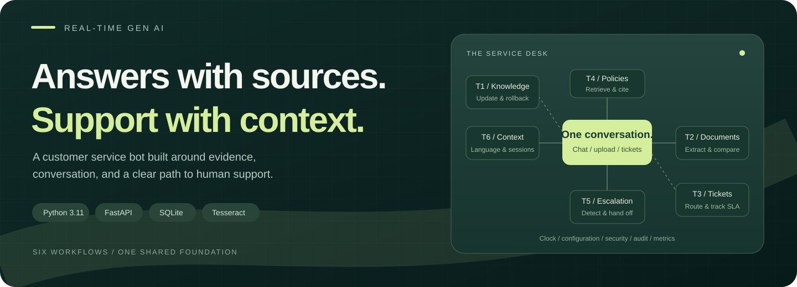
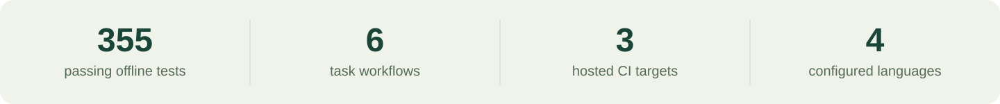
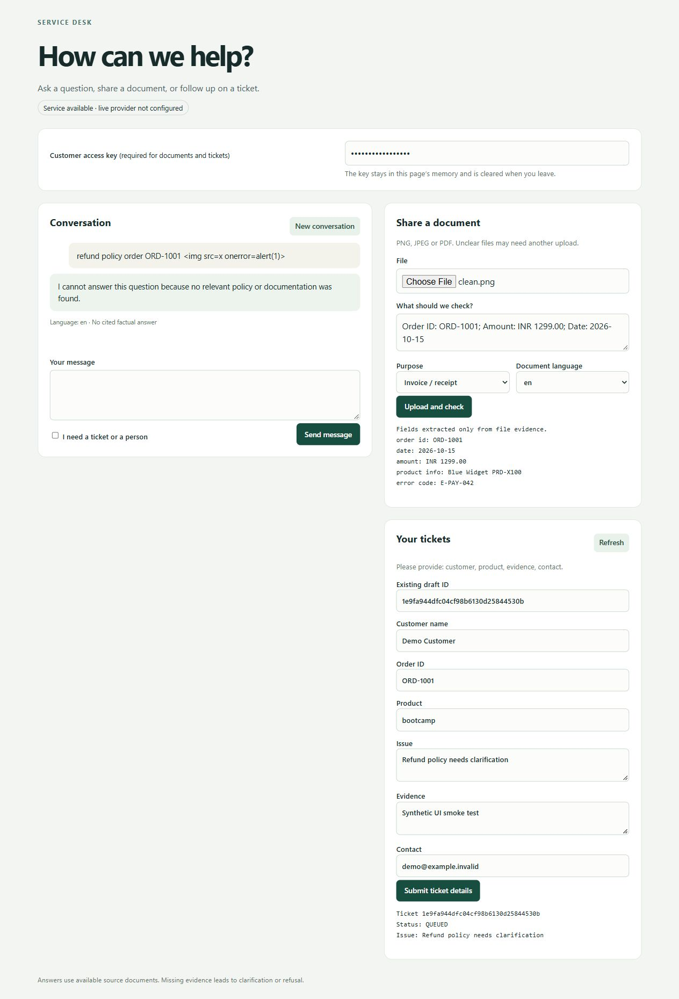
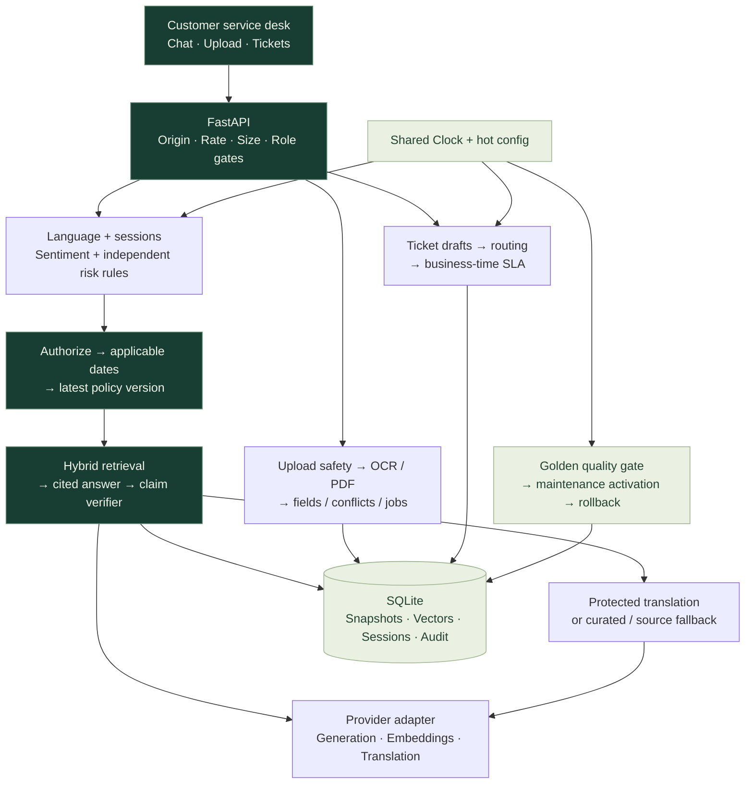

<p align="center">
  
</p>

<p align="center">
  <a href="https://github.com/rxp017/Real_Time_Gen_AI_Customer_Service_Bot/actions/workflows/ci.yml"></a>
  
  
  
</p>

<h1 align="center">Real-Time Gen AI Customer Service Bot</h1>

<p align="center">
  Ask a question. Check a document. Keep the conversation moving.<br>
  A Python service connecting policy evidence, multilingual context, and support workflows.
</p>

<p align="center">
  <a href="#see-the-service-desk">Preview</a> &nbsp; / &nbsp;
  <a href="#run-it-locally">Quickstart</a> &nbsp; / &nbsp;
  <a href="#six-tasks-one-foundation">Six tasks</a> &nbsp; / &nbsp;
  <a href="docs/REPORT.md">Engineering report</a> &nbsp; / &nbsp;
  <a href="docs/video/google-vids-production.md">Video production kit</a>
</p>



<p align="center"><sub>Engineering snapshot: 19 October 2026. Coverage counts describe tested contracts, not general model accuracy. <a href="docs/verification/readme-video-pytest.txt">Test output</a> · <a href="https://github.com/rxp017/Real_Time_Gen_AI_Customer_Service_Bot/actions/runs/39277200539">Verified implementation CI</a></sub></p>

## See the service desk

One customer page brings together chat, document upload, and ticket follow-up. Responses expose their source and language; missing information can lead to clarification or refusal.

<details>
<summary><strong>Open the actual interface preview</strong></summary>
<br>



<sub>Captured local UI smoke test with synthetic data and an unconfigured live provider. The visible test string demonstrates literal text rendering. This is an actual application capture.</sub>

</details>

| Ask with evidence | Share a document | Continue the conversation |
| --- | --- | --- |
| Policies, FAQs and troubleshooting guides share metadata, access rules and dated versions. Answers cite their evidence. | Invoice extraction returns visible fields, confidence and source regions. Conflicting values ask for clarification. | Language, corrections and session context feed ticket drafts, routing and business-time SLA tracking. |

**Demo route:** [local UI](http://127.0.0.1:8000/) after startup · [offline demonstrations](#demo-and-video) · [deployment guide](docs/deploy-render.md). **Public live URL: not deployed.**

## Run it locally

Clone the project first:

```sh
git clone https://github.com/rxp017/Real_Time_Gen_AI_Customer_Service_Bot.git
cd Real_Time_Gen_AI_Customer_Service_Bot
```

### Docker

The image includes Tesseract with English, Hindi, Telugu and Spanish resources. It uses one worker and a persistent data volume.

```sh
[ -f .env ] || cp .env.example .env
docker build -t customer-service-bot .
docker run --rm -p 8000:8000 --env-file .env -v customer-service-data:/app/data customer-service-bot
```

The copy command above is for a POSIX shell. In PowerShell, use `if (-not (Test-Path .env)) { Copy-Item .env.example .env }`, followed by the same Docker commands.

<details>
<summary><strong>Linux / Ubuntu — Python 3.11</strong></summary>

Use an installed Python 3.11 interpreter, then install OCR and the pinned Python packages:

```sh
sudo apt-get update
sudo apt-get install -y python3-venv tesseract-ocr tesseract-ocr-eng tesseract-ocr-hin tesseract-ocr-tel tesseract-ocr-spa
python3.11 -m venv .venv
. .venv/bin/activate
python -m pip install -r requirements.txt
[ -f .env ] || cp .env.example .env
python scripts/check_ocr.py
python -m uvicorn app.chatbot:app --host 127.0.0.1 --port 8000 --workers 1
```

OCR uses PATH and auto-detects the system language directory. `python scripts/fetch_tessdata.py` can install tagged local language resources instead.

</details>

<details>
<summary><strong>Windows — PowerShell bootstrap</strong></summary>

Run from the project root. The bootstrap installs an isolated official Python 3.11.9 runtime, pinned dependencies and language resources, preserving an existing `.env`.

```powershell
if (-not (Get-Command tesseract -ErrorAction SilentlyContinue) -and -not (Test-Path (Join-Path $env:ProgramFiles 'Tesseract-OCR/tesseract.exe'))) {
    winget install --id UB-Mannheim.TesseractOCR --source winget --exact --version 5.4.0.20240606 --silent --accept-package-agreements --accept-source-agreements
}
.\scripts\bootstrap_windows.ps1
.\.runtime\python311\python.exe -m uvicorn app.chatbot:app --host 127.0.0.1 --port 8000 --workers 1
```

OCR prefers PATH, with the standard Windows installation as fallback. A runtime configuration override takes precedence over `TESSERACT_CMD`.

</details>

Open **[localhost:8000](http://127.0.0.1:8000/)**. For live generation, put your own Google key and distinct application role keys in `.env`. Uploads and tickets require a customer role key; the provider key belongs on the server. Without a configured provider, the application starts and refuses factual answers it cannot produce.

Generate application keys privately with `python -c "import secrets; print(secrets.token_urlsafe(32))"`. The [environment template](.env.example) lists each role. The documented generation model is `gemini-2.5-flash`; the example fallback list is empty because other candidates lack successful generation evidence. [Provider proof](docs/verification/provider-flash-probe.json).

## Six tasks, one foundation

| Task | Requirement → implementation | Representative verification |
| --- | --- | --- |
| **01 · Knowledge updates** | Normalize/hash, dedupe, quarantine, quality gate, maintenance activation and rollback → [ingestion](core/ingestion.py), [updates](core/updates.py), [store](core/store.py) | `test_duplicate_documents_detected` · `test_retry_15_30_60` · `test_quality_gate_uses_ingested_hybrid_vectors` |
| **02 · Document understanding** | Upload safety, real OCR/PDF extraction, conflicts, jobs and retention → [upload gate](core/upload_gate.py), [OCR](core/ocr.py), [uploads](core/uploads.py) | `test_missing_field_not_invented` · `test_mismatched_invoice_asks_clarification` · `test_expired_files_deleted` |
| **03 · Ticket handling** | Mandatory fields, priority, dedupe, routing and business-time SLA → [tickets](core/tickets.py), [priority](core/priority.py), [calendar](core/business_time.py) | `test_priority_formula` · `test_duplicate_ticket_merged` · `test_runtime_sla_change_recomputes` |
| **04 · Policy answers** | Authorized, applicable, latest-version hybrid retrieval and cited claims → [retrieval](core/retrieval.py), [embeddings](core/embeddings.py), [original FAQ import](core/training.py) | `test_filters_and_versions_precede_all_similarity` · `test_top_k_generation_verifies_each_citation_against_its_own_source` |
| **05 · Escalation** | History-aware sentiment, separate risk rules and masked handoff → [sentiment](core/sentiment.py), [risk](core/risk.py), [escalation](core/escalation.py) | `test_high_risk_independent_of_provider_positive_label` · `test_tone_changes_policy_unchanged` |
| **06 · Language & context** | Protected entities, language switching, corrections and isolated sessions → [language](core/language.py), [entities](core/entities.py), [sessions](core/sessions.py) | `test_provider_translation_preserves_original_entity_bytes` · `test_concurrent_sessions_isolated` |

The [full requirements matrix](docs/RTM.md) records requirement-level evidence and remaining partial capabilities.

## How the pieces connect



All time-sensitive behavior uses the shared Clock. Thresholds, languages, roles and timing come from [configuration](config/default.yaml). Retrieved and uploaded text is untrusted data. Provider retries respect request deadlines; successful classification caching is bounded, masked and scoped to sessions.

## Demo and video

The demonstrations below are **offline fixture runs** using FakeClock/FakeLLM and real local storage. Their outputs do not establish live model accuracy.

```sh
python scripts/demo_t4.py
python scripts/demo_t1.py
python scripts/demo_t2.py
python scripts/demo_t3.py
python scripts/demo_t5.py
```

On Windows, replace `python` with `.\.runtime\python311\python.exe`.

**Making the walkthrough in Google Vids?** The [production kit](docs/video/google-vids-production.md) contains the avatar, room, lighting and voice direction, plus a timed shot plan. [Copy-ready scene prompts](docs/video/scene-prompts.md) specify dialogue, framing, lens intent, movement and continuity. [Capture checklist](docs/demo-script.md).

The plan combines generated presenter shots with actual app/demo recordings. **The video has not been generated or published.**

## Verification you can inspect

```sh
python -m pytest -q
python -m ruff check .
python scripts/check_holdouts.py
```

| Evidence | Recorded result |
| --- | --- |
| [Full local suite](docs/verification/readme-video-pytest.txt) | `355 passed, 1 warning in 98.05s` |
| [Ruff](docs/verification/readme-video-ruff.txt) | `All checks passed!` |
| [Fresh application clone](docs/verification/revision-fresh-pytest.txt) | `352 passed, 1 warning`; the extra three final tests cover documentation redaction |
| [Hosted CI snapshot](https://github.com/rxp017/Real_Time_Gen_AI_Customer_Service_Bot/actions/runs/39277200539) | Ubuntu, Windows and Docker passed for `ea7a845` |
| [Frozen-set guards](scripts/check_holdouts.py) | Immutable hashes and complete-text contamination checks |

### Measured quality and honest limits

| Evaluation | Observed result | What it establishes |
| --- | --- | --- |
| T4 pre-fix exposed set | 3/20 correct cited answers; 0/52 false answers | Historical result retained |
| T4 post-fix re-evaluation | 12/20 correct cited answers; 0/52 false answers | **Invalid run:** 10/72 provider failures = 13.89%, above the preregistered 10% limit |
| T5 exposed set | Pre-fix pipeline 22/48; post-fix fallback-only 20/48 | Live post-fix classification was skipped under quota; fallback is not model-assisted accuracy |
| Translation | Live probes returned HTTP 429 | Successful live translation remains unverified |

Tuned development retrieval reached 48/48 correct cited answers and 0/38 false answers with 100 distractors, using recorded real embeddings and deterministic source quotation. That is a dev regression, not live generation accuracy. [All runs, Wilson intervals and protocol](docs/REPORT.md).

Rules, OCR and name detection have bounded coverage. Source checks do not certify translation meaning. The legacy training chain is unverified. Alerts/helpdesk events are local records; SQLite and timers need one running worker and persistent storage. Render Free sleeps and has ephemeral disk. **No public live deployment is claimed.**

## Project roots and reading list

This project extends the mentor's [customer_service_chatbot_LLM training project](https://github.com/aslin72/GEN---AI-course/tree/main/GEN---AI-course/customer_service_chatbot_LLM). Original `src/` entry points and `dataset/dataset.csv` bytes are retained. The FAQ data is imported into metadata-bearing documents for a configured new empty store; existing ACTIVE snapshots are preserved.

| Understand the system | Review the evidence | Run or present it |
| --- | --- | --- |
| [Architecture & decisions](docs/REPORT.md) | [Requirements matrix](docs/RTM.md) | [Render deployment](docs/deploy-render.md) |
| [Engineering report PDF](docs/REPORT.pdf) | [Known gaps](docs/known_gaps.md) | [Google Vids production kit](docs/video/google-vids-production.md) |
| [Original baseline](docs/baseline.md) | [Assumptions](docs/assumptions.md) | [Scene prompts](docs/video/scene-prompts.md) |

<p align="center"><sub>Historical audits and command output are retained in <a href="docs/archive/README.md">the archive</a>. Current claims link to their evidence.</sub></p>
