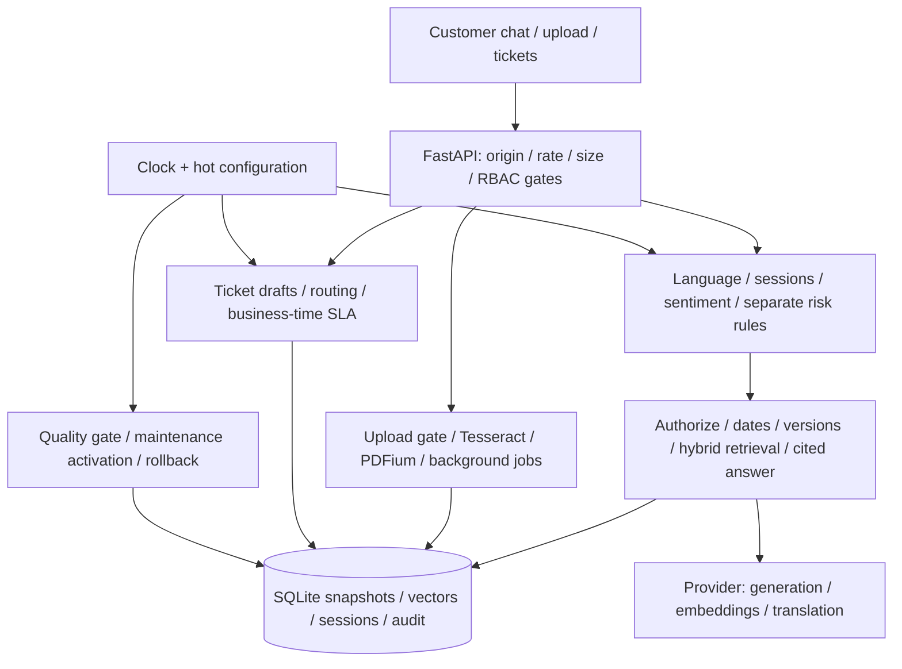

# Customer service bot

A Python 3.11/FastAPI customer-service application with policy citations, controlled knowledge updates, document extraction, multilingual sessions, escalation and tickets. It extends the mentor's [customer_service_chatbot_LLM training project](https://github.com/aslin72/GEN---AI-course/tree/main/GEN---AI-course/customer_service_chatbot_LLM). The original `dataset/dataset.csv` and `src/` entry points are retained; the FAQ CSV is imported into the shared document schema when a configured service initializes a new store.

## Architecture



## Tasks and coverage

| Task requirement | Main modules | Representative tests |
| --- | --- | --- |
| T1: hash/dedupe, quarantine, quality gate, timed activation and rollback | `core/ingestion.py`, `updates.py`, `store.py` | `test_duplicate_documents_detected`, `test_retry_15_30_60`, `test_quality_gate_uses_ingested_hybrid_vectors` |
| T2: bounded uploads, actual extraction, conflicts, retention | `core/upload_gate.py`, `ocr.py`, `uploads.py` | `test_missing_field_not_invented`, `test_mismatched_invoice_asks_clarification`, `test_expired_files_deleted` |
| T3: mandatory ticket fields, priority, business SLA and routing | `core/tickets.py`, `priority.py`, `business_time.py` | `test_priority_formula`, `test_runtime_sla_change_recomputes` |
| T4: filtered hybrid retrieval, FAQ/guide metadata, citations | `core/retrieval.py`, `embeddings.py`, `training.py` | `test_hybrid_query_to_cited_answer`, `test_filters_and_versions_precede_all_similarity`, `test_training_faqs_are_ingested_with_metadata` |
| T5: provider sentiment with pattern fallback; independent risk | `core/sentiment.py`, `risk.py`, `escalation.py` | `test_classifier_output_enum_and_schema_validation`, `test_high_risk_independent_of_provider_positive_label` |
| T6: language/context, protected translation, isolated sessions | `core/language.py`, `entities.py`, `sessions.py` | `test_provider_translation_preserves_original_entity_bytes`, `test_concurrent_sessions_isolated` |

[Full requirements matrix](docs/RTM.md) · [Engineering report](docs/REPORT.md) · [PDF report](docs/REPORT.pdf)

## Quickstart: Linux

Use Python 3.11 (already installed), with Debian/Ubuntu OCR packages:

```sh
sudo apt-get update
sudo apt-get install -y python3-venv tesseract-ocr tesseract-ocr-eng tesseract-ocr-hin tesseract-ocr-tel tesseract-ocr-spa
python3.11 -m venv .venv
. .venv/bin/activate
python -m pip install -r requirements.txt
[ -f .env ] || cp .env.example .env
python scripts/check_ocr.py
python -m uvicorn app.chatbot:app --host 127.0.0.1 --port 8000 --workers 1
```

No OCR environment overrides are needed. The system language directory is detected automatically. An optional `python scripts/fetch_tessdata.py` installs tagged local resources.

## Quickstart: Windows

Run from the cloned project root in PowerShell. The bootstrap creates an isolated official Python 3.11.9 runtime and installs pinned dependencies/language resources, preserving an existing `.env`:

```powershell
if (-not (Get-Command tesseract -ErrorAction SilentlyContinue) -and -not (Test-Path (Join-Path $env:ProgramFiles 'Tesseract-OCR/tesseract.exe'))) {
    winget install --id UB-Mannheim.TesseractOCR --source winget --exact --version 5.4.0.20240606 --silent --accept-package-agreements --accept-source-agreements
}
.\scripts\bootstrap_windows.ps1
```

```powershell
.\.runtime\python311\python.exe -m uvicorn app.chatbot:app --host 127.0.0.1 --port 8000 --workers 1
```

OCR discovery prefers PATH, with the standard Windows location as fallback. A runtime config override takes precedence over `TESSERACT_CMD`.

## Quickstart: Docker

```sh
[ -f .env ] || cp .env.example .env
docker build -t customer-service-bot .
docker run --rm -p 8000:8000 --env-file .env -v customer-service-data:/app/data customer-service-bot
```

The image includes Tesseract and eng/hin/tel/spa, runs as UID 1000 and starts one worker. The volume holds SQLite, uploads, quarantine and inbox state.

## Configuration and demo

Open the [local customer UI](http://127.0.0.1:8000/). Fill `.env` with your own Google key and distinct random application role keys before live use. Generate keys locally with `python -c "import secrets; print(secrets.token_urlsafe(32))"`; keep the output private. Never put the Google key in the browser. Uploads and tickets require a customer key. With no provider configured, the app starts but refuses unsupported factual answers.

The default generation model is `gemini-2.5-flash`, supported by [successful provider evidence](docs/verification/provider-flash-probe.json). Fallback models are empty because no other model has proven successful generation. Model eligibility does not establish the account's billing tier or available quota. Languages, thresholds, weights and timings live in `config/default.yaml` and `resources/languages/`.

Demo: [UI screenshot](docs/assets/customer-ui.jpg), [2–5 minute video script](docs/demo-script.md), and `python scripts/demo_t1.py` / `python scripts/demo_t4.py` for explicitly offline FakeClock/FakeLLM demonstrations. Live URL: **not deployed**. [Render deployment guide](docs/deploy-render.md).

## Verification

```sh
python -m pytest -q
python -m ruff check .
python scripts/export_report.py
```

On Windows, substitute `.\.runtime\python311\python.exe` for `python`. [CI](https://github.com/rxp017/Real_Time_Gen_AI_Customer_Service_Bot/actions/workflows/ci.yml) installs OCR and runs the full suite/Ruff on Ubuntu and Windows, plus a Docker build/OCR check. Current command outputs and frozen-set measurements are in [the report](docs/REPORT.md). Historical audits and verification exhaust are preserved in [docs/archive](docs/archive/README.md).

## Measured results and limits

Pre-fix exposed sets: T4 3/20 correct-cited answers (15.00%), 0/52 false answers; T5 pipeline 22/48 (45.83%), six accepted provider classifications. Post-fix T4 observed 12/20 correct-cited answers and 0/52 false answers, but the run is **invalid**: provider failures affected 10/72 cases (13.89%), above the preregistered 10% limit. The user chose quota-limited completion; no optional rerun or live T5 post-fix run was taken. Separate T5 pattern-only re-evaluation: 20/48 (41.67%). These exposed sets were not used for tuning. [All runs, Wilson intervals and protocol](docs/REPORT.md).

The independent tuned T4 dev regression achieved 48/48 correct-cited answers and 0/38 false answers with 100 distractors using recorded real embeddings and deterministic source quotation; this is not live generation accuracy. Live translation still hit HTTP 429, so no live translation success is claimed. Rules/OCR/name recognition are bounded; translation bytes do not certify meaning. The legacy Streamlit chain is unverified. SQLite and timers require one worker; external alerts remain local records. Render Free sleeps and loses ephemeral state. Live URL: not deployed.
## Measured results and limits

Pre-fix exposed sets: T4 3/20 correct-cited answers (15.00%), 0/52 false answers; T5 pipeline 22/48 (45.83%), six accepted provider classifications. Post-fix T4 observed 12/20 correct-cited answers and 0/52 false answers, but the run is **invalid**: provider failures affected 10/72 cases (13.89%), above the preregistered 10% limit. The user chose quota-limited completion; no optional rerun or live T5 post-fix run was taken. Separate T5 pattern-only re-evaluation: 20/48 (41.67%). These exposed sets were not used for tuning. [All runs, Wilson intervals and protocol](docs/REPORT.md).

The independent tuned T4 dev regression achieved 48/48 correct-cited answers and 0/38 false answers with 100 distractors using recorded real embeddings and deterministic source quotation; this is not live generation accuracy. Live translation still hit HTTP 429, so no live translation success is claimed. Rules/OCR/name recognition are bounded; translation bytes do not certify meaning. The legacy Streamlit chain is unverified. SQLite and timers require one worker; external alerts remain local records. Render Free sleeps and loses ephemeral state. Live URL: not deployed.
